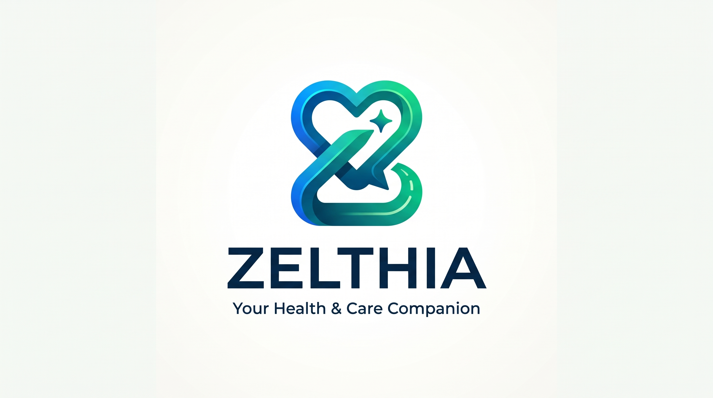
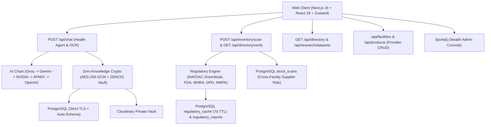

# Zelthia



Zelthia pairs an inventory, pack-verification, and public listing system for pharmacies, clinics, hospitals, diagnostic centres, and health stores with an AI patient health chat, a handwritten prescription/note reader, and a country-scoped search for in-stock medicines and diagnostic services. Built Nigeria-first with multi-country geolocation and regional purchasing-power pricing.

> Clinical notice: Zelthia provides informational guidance and helps locate stock or diagnostic services. It does not diagnose illness, prescribe medicine, or sell or dispense products, and it does not replace a licensed doctor or pharmacist. In an emergency in Nigeria, call 112.

## Product demo

[](./vid/zelthia-demo.mp4)

- Repository file: [`vid/zelthia-demo.mp4`](./vid/zelthia-demo.mp4) (2 min 05 sec, 1920x1080 H.264/AAC, ~11 MB)
- Direct stream or download: <https://github.com/kingjethro999/zelthia/raw/main/vid/zelthia-demo.mp4>

<video src="./vid/zelthia-demo.mp4" controls preload="metadata" poster="./public/zelthiabanner.jpeg" width="100%"></video>

The walkthrough covers:

1. Patient health chat with allergy and medication context, plus photo reading for handwritten prescriptions and clinical notes.
2. Public medicine and test lookup scoped to verified nearby facilities with prices, stock counts, and landmark or voice directions.
3. Facility inventory management, licence verification, and live regulatory pack checks.

## What is live on the web

### For patients and shoppers (`/chat`, `/inventory`, `/doctors-note-reader`, `/facility/[id]`)

- Health chat (`/chat`) takes an optional encrypted health profile (age, sex, height, weight, blood group, allergies, chronic conditions, and active medicines) into account, flags drug-allergy and drug-drug risks, runs automatic emergency red-flag detection, streams tool activity, fails over across configured inference providers (`Groq`, `Google Gemini`, `NVIDIA NIM`, `APMIX`, `OpenAI`), and falls back deterministically when providers are unavailable. It works with or without an account.
- The doctor's note and prescription reader (`/doctors-note-reader`, `/chat`) transcribes handwritten notes, prescriptions, referral slips, lab results, and product cartons from photos or PDFs (`unpdf` plus multimodal vision models), expands clinical shorthand, and queries facilities carrying the prescribed items or tests.
- The medicine, product, and service directory (`/inventory`) searches real facility listings scoped to the visitor's country and city (resolved via edge geo headers, `ipwho.is` IP lookup, or opt-in browser coordinates rounded to ~100 m through OpenStreetMap Nominatim). Verified facilities rank first. Listings show live quantities, prices, opening hours, written landmark directions, and recorded audio directions. When no local facility stocks an item, web fallback results are separated and marked unverified with source URLs.
- Pack and registration verification (`/inventory`, `/api/directory/verify`) checks barcodes (EAN-13, EAN-8, UPC-A, GS1 DataMatrix `(01)`/`(17)`/`(10)`/`(21)`), NAFDAC registration numbers, US NDCs, UK MHRA PL numbers, Health Canada DINs, China NMPA codes, or carton photos against official public registers. Output distinguishes code matches, name matches, post-market safety signals, and upstream outages (an unreachable register reports "could not check" and is never cached or treated as unlisted).

### For health facilities (`/provider`, `/for-facilities`, `/facility/[id]`, `/sticker/[id]`, `/pricing`)

- The inventory and services dashboard (`/provider`) supports one or multiple branches (pharmacies, clinics, hospitals, diagnostic/scan centres, and health stores) with one-tap quantity adjustments, per-product low-stock thresholds, a 90-day expiry view, prescription-only flags, and listed clinical or diagnostic services (X-ray, ultrasound, ECG, laboratory tests).
- Scan-to-Stock (`POST /api/inventory/scan`) uses the browser `BarcodeDetector` API with a pure-JS 1D EAN-13/EAN-8 canvas fallback plus carton OCR to pre-fill product fields, run live multi-regulator checks, and store server-issued `regulatory_reports`. Product saves keep a regulatory status only when backed by a matching server report (`verdict` and product match). Each scanned carton is logged in `stock_scans` with its supplier, raising a 90-day cross-facility caution flag (`SUPPLIER_RISK`) when other facilities recorded danger verdicts for cartons from a supplier with the same normalized name.
- Facilities publish written landmark instructions and can record voice directions in the browser (`MediaRecorder` to encrypted private Cloudinary storage and Groq Whisper transcription).
- Public facility pages (`/facility/[id]`) render `schema.org` JSON-LD (`Pharmacy`, `MedicalClinic`, `Hospital`, `DiagnosticLab`, `HealthAndBeautyBusiness`), and verified profiles appear in `/sitemap.xml`. `/sticker/[id]` generates a print-ready A6 (`105 x 148 mm`) counter sticker with a level-`H` error-corrected QR code linking to the facility's live stock page.
- Submitted licence numbers (such as PCN, MDCN, or HEFAMAA) are checked against `.gov.ng` sources for preliminary evidence and queued for administrator review. Basic listing is free today and stays free. Upcoming paid tiers (`Verified Pro` and `Diagnostic & Hospital Plus`, plus mobile `Companion`) use regional pricing (`NGN` in Nigeria, `USD` internationally) and never bypass licence verification (`/pricing`).

## Regulatory, statutory, and health-economics datasets

| Dataset / Register                         | Coverage & Scale                                                                                                                                                                          | Code Module                                                                                                                                                                  |
| ------------------------------------------ | ----------------------------------------------------------------------------------------------------------------------------------------------------------------------------------------- | ---------------------------------------------------------------------------------------------------------------------------------------------------------------------------- |
| Nigeria NAFDAC Greenbook & Alerts          | Direct DataTables JSON lookup (`greenbook.nafdac.gov.ng`) by exact NRN (`A4-9674`) and product name with polite throttling + ZenRows relay fallback; NAFDAC alerts/recalls                | [`lib/server/greenbook.ts`](./lib/server/greenbook.ts), [`lib/server/regulatory.ts`](./lib/server/regulatory.ts)                                                             |
| US FDA Orange Book (`EOBZIP_2026_10`)      | `48,990` indexed product rows with active/discontinued status, patent counts, and exclusivity dates                                                                                       | [`lib/server/orange-book.ts`](./lib/server/orange-book.ts), `data/EOBZIP_2026_10/`                                                                                           |
| US openFDA live REST APIs                  | 7 live endpoints: `drug/ndc`, `drug/drugsfda`, `drug/label` (Boxed Warnings & contraindications), `drug/event` (FAERS), `drug/enforcement`, `food/enforcement`, `cosmetic/event` (CAERS)  | [`lib/server/openfda.ts`](./lib/server/openfda.ts)                                                                                                                           |
| UK MHRA Safety PARs & reference            | `61` Safety Public Assessment Reports (2006 to 2026) with clinical class expansion, `HC 516` 2025-2026 Annual Report (`186` pp.), 2026 leadership directorates, 15-section Privacy Notice | [`lib/server/mhra.ts`](./lib/server/mhra.ts), [`lib/server/datasets/`](./lib/server/datasets)                                                                                |
| Health Canada DPD & China NMPA             | Live Health Canada Drug Product Database DIN queries (`health-products.canada.ca/api/drug`) and Guoyao Zhunzi code parsing                                                                | [`lib/server/regulatory.ts`](./lib/server/regulatory.ts), [`lib/barcode.ts`](./lib/barcode.ts)                                                                               |
| England Adult Social Care 2025-2026        | `509,352` DHSC CSV rows aggregated across England (`£31,643,733k` gross / `£26,684,153k` net expenditure), `9` regions, and `153` Local Authorities                                       | [`lib/server/social-care.ts`](./lib/server/social-care.ts), [`lib/server/datasets/adult-social-care-2025-2026.json`](./lib/server/datasets/adult-social-care-2025-2026.json) |
| UK Data Protection Act 2018 (`2018 c. 12`) | `354`-page statute (`11` indexed provisions) + `18`-page National Security Certificates Guidance                                                                                          | [`lib/server/compliance.ts`](./lib/server/compliance.ts), [`lib/server/datasets/ukpga-dpa2018.json`](./lib/server/datasets/ukpga-dpa2018.json)                               |

## Security, encryption, and data protection

### Split-key envelope encryption ([`lib/server/crypto.ts`](./lib/server/crypto.ts))

Account passwords are hashed with `scrypt` (`N=16384, r=8, p=1`), using a constant-work dummy verification path for unknown email addresses. Each user receives a random 256-bit Data Encryption Key (`DEK`) wrapped by a password-derived `KEK` via `AES-256-GCM` (`zelthia:dek:v1` AAD). Health profiles (`data_enc`), conversation titles (`title_enc`), chat messages (`payload_enc`), and private media attachments (`ZENC\x01` binary envelope in Cloudinary) are sealed at rest.

### Enforced statutory privacy rights (NDPA 2023, UKPGA DPA 2018, and UK GDPR)

- Explicit consent is recorded at signup in `users.consent_history` alongside `terms_version`.
- Subject Access Request and portability exports run via `GET /api/account/export` (DPA 2018 s. 45 / UK GDPR Art. 15 & 20).
- Runtime Right to Restrict Processing (`users.processing_restricted`, DPA 2018 s. 47 / UK GDPR Art. 18) forces transient non-persisted chat in `POST /api/chat` and blocks profile writes (`409 Conflict`) in `PUT /api/account` while active.
- Automated triage and facility licensing keep human-in-the-loop review under DPA 2018 s. 14 / UK GDPR Art. 22.
- Account deletion (`DELETE /api/account`) cascades across sessions, messages, facilities, and stored media, alongside multi-device session revocation (`POST /api/auth/sessions/revoke-others`).

### Application and network hardening

- Split session cookies (`HTTP-only`, `SameSite=Lax`) are hashed with SHA-256 in PostgreSQL.
- Mutating API routes validate `Origin`, uploaded files pass magic-byte verification ([`lib/server/file-sniff.ts`](./lib/server/file-sniff.ts)), and PostgreSQL enforces sliding-window rate limits (`rate_limits`).
- Outbound HTTP passes through [`lib/server/http.ts`](./lib/server/http.ts), blocking private, loopback, link-local, and cloud metadata IP ranges.
- [`next.config.ts`](./next.config.ts) sets `Content-Security-Policy`, `X-Frame-Options: DENY`, `X-Content-Type-Options: nosniff`, `Cross-Origin-Opener-Policy: same-origin`, production HSTS, and sandboxed headers on `/api/attachments/*`.
- The stealth admin portal (`app/(adm)/[portal]/...`) is gated by `ADMIN_ROUTE_SLUG` and the `ADMIN_EMAIL` allowlist, logging moderation actions to `admin_audit_log`. `/admin` returns `404`.

## System architecture



## Repository structure

```text
zelthia/
├── app/
│   ├── (adm)/[portal]/       # Stealth admin dashboard (overview, facilities, inventory, verifications, users, audit, system)
│   ├── (auth)/               # /signin, /signup, /setup
│   ├── (marketing)/          # /, /about, /for-facilities, /doctors-note-reader, /pricing, /coming-soon, /facility/[id], /privacy, /terms
│   ├── (workspace)/          # /inventory, /provider, /provider/new, /account
│   ├── api/                  # REST routes: auth, account, chat, conversations, directory, facilities, products, geo, research, admin
│   ├── chat/                 # /chat and /chat/[id]
│   ├── sticker/[id]/         # Printable A6 facility QR sticker
│   ├── llms.txt/             # Machine-readable summary for AI agents
│   ├── llms-full.txt/        # Extended documentation + FAQs for AI agents
│   └── openapi.json/         # OpenAPI 3.1 spec for public endpoints
├── components/               # UI primitives, admin, chat, inventory (ScanToStockSheet), marketing, profile, providers
├── data/                     # Local public FDA Orange Book files (EOBZIP_2026_10/) & reference docs
├── lib/
│   ├── ai/                   # Tool-calling health agent, multi-provider client, system prompts, offline fallback
│   ├── server/               # Postgres schema/pool, crypto, auth, greenbook, openfda, orange-book, mhra, social-care, compliance, geo, http
│   ├── store/                # Zustand client stores (session, chat, location)
│   └── barcode.ts            # EAN-13/EAN-8, GS1 DataMatrix parser & 1D canvas decoder
├── scripts/
│   ├── build-public-datasets.mjs      # Builds lib/server/datasets/*.json from official public reports
│   ├── seed-admin.mjs                 # Seeds/resets an admin account with wrapped DEK
│   └── verify-seo-and-routes.mjs      # Verifies App Router structure, sitemap, robots, and JSON-LD
├── vid/                      # Product demo video (zelthia-demo.mp4)
└── mobile/                   # Native Android (Kotlin/Compose), iOS (Swift placeholder), and wake-word ONNX/TFLite assets
```

## Database schema

Tables and additive migrations live in `SCHEMA` inside [`lib/server/db.ts`](./lib/server/db.ts) and run automatically on the first database query (`ensureSchema()`):

| Table                        | Purpose                                                                                                         |
| ---------------------------- | --------------------------------------------------------------------------------------------------------------- |
| `users`                      | Accounts, `scrypt` hashes, wrapped per-user `DEK`, `role`, consent version/history, `processing_restricted`     |
| `sessions`                   | SHA-256 hashed HTTP-only session tokens and expiration                                                          |
| `health_profiles`            | AES-256-GCM sealed patient biometrics, allergies, conditions, and medications                                   |
| `conversations` / `messages` | AES-256-GCM sealed chat threads and turn payloads                                                               |
| `attachments`                | Encrypted upload metadata referencing private Cloudinary objects or encrypted local blobs                       |
| `facilities`                 | Registered pharmacies, clinics, hospitals, scan centres, stores, services, and verification evidence            |
| `products`                   | Branch SKUs, prices, quantities, batches, expiry dates, barcodes, NAFDAC numbers, and trusted regulatory status |
| `regulatory_cache`           | 7-day cache for successful external regulator lookups                                                           |
| `regulatory_reports`         | Server-issued verification reports paired against product saves                                                 |
| `stock_scans`                | Facility Scan-to-Stock intake log powering 90-day cross-facility supplier warnings                              |
| `rate_limits`                | PostgreSQL sliding-window rate-limit log                                                                        |
| `admin_audit_log`            | Immutable log of admin moderation and maintenance actions                                                       |

## Public, workspace, and agent APIs

Public read-only endpoints:

- `GET /api/directory`: Country-scoped search across verified and listed facility stock and services (`q`, `country`, `city`, `category`, `inStock`).
- `GET /api/directory/verify` & `POST /api/directory/verify`: Live regulatory verification for a medicine name, barcode/GTIN, NAFDAC number, foreign pack code, or pack image.
- `GET /api/research/datasets`: Read-only explorer (`source=overview|mhra|dpa|social-care|orange-book`, `q`, `limit`).
- `GET /api/geo`, `/api/geo/countries`, `/api/geo/regions`, `/api/geo/reverse`: Country/region metadata and ~100 m reverse geocoding.
- `GET /openapi.json`: OpenAPI 3.1 schema for public agent-callable endpoints.
- `GET /llms.txt` & `GET /llms-full.txt`: Machine-readable platform documentation.

Authenticated APIs cover `/api/auth/*`, `/api/account`, `/api/account/export`, `/api/chat`, `/api/conversations/*`, `/api/attachments/[id]`, `/api/facilities/*`, `/api/products/[id]`, `/api/inventory/scan`, and `/api/admin/*`.

## Getting started

You need Node.js 20+, pnpm 12+ (`packageManager: pnpm@12.23.0`), and PostgreSQL 14+.

```bash
pnpm install
cp .env.example .env
# Fill DATABASE_URL and at least one AI provider key in .env
pnpm dev
```

Open <http://localhost:3000>. Tables are created automatically on the first database request.

### Scripts and commands

| Command                                                                  | Description                                                                       |
| ------------------------------------------------------------------------ | --------------------------------------------------------------------------------- |
| `pnpm dev`                                                               | Start Next.js 16 Turbopack dev server                                             |
| `pnpm build`                                                             | Create production build (`next build`)                                            |
| `pnpm start`                                                             | Serve production build (`next start`)                                             |
| `pnpm lint`                                                              | Run ESLint (`eslint-config-next`)                                                 |
| `pnpm format`                                                            | Format workspace files with Prettier                                              |
| `pnpm exec tsc --noEmit`                                                 | Run TypeScript type check                                                         |
| `node scripts/build-public-datasets.mjs`                                 | Rebuild [`lib/server/datasets/`](./lib/server/datasets) JSON indexes from `data/` |
| `node scripts/seed-admin.mjs --email admin@example.com --password "..."` | Create or reset an admin user with a wrapped DEK                                  |
| `node scripts/verify-seo-and-routes.mjs`                                 | Verify required Next.js routes, sitemap, robots, and JSON-LD                      |

## Environment variables

Copy [`.env.example`](./.env.example) to `.env`. Never commit `.env` or expose server secrets under `NEXT_PUBLIC_*`.

| Group               | Variables                                                                                                                                                                                                                         | Notes                                                                                                   |
| ------------------- | --------------------------------------------------------------------------------------------------------------------------------------------------------------------------------------------------------------------------------- | ------------------------------------------------------------------------------------------------------- |
| Site & Geo          | `NEXT_PUBLIC_SITE_URL`, `NEXT_PUBLIC_CONTACT_EMAIL`, `DEFAULT_COUNTRY`                                                                                                                                                            | Canonical URL, contact address, loopback fallback country (default `NG`)                                |
| PostgreSQL          | `DATABASE_URL`, `DATABASE_CA_CERT`                                                                                                                                                                                                | Connection string (strict TLS for non-local hosts; optional PEM CA with `\n`)                           |
| Stealth Admin       | `ADMIN_EMAIL`, `ADMIN_ROUTE_SLUG`                                                                                                                                                                                                 | Comma-separated allowlist + 16 to 128 char URL-safe path segment for `/(adm)/[portal]`                  |
| AI & Speech         | `AI_PROVIDER_ORDER`, `AI_REQUEST_TIMEOUT_MS`, `AI_MAX_FALLBACKS`, `GROQ_API_KEY`, `GROQ_MODEL`, `GROQ_TRANSCRIPTION_MODEL`, `GEMINI_API_KEY`, `GEMINI_MODEL`, `NVIDIA_API_KEY`, `NVIDIA_MODEL`, `APMIX_API_KEY`, `OPENAI_API_KEY` | Providers run in `AI_PROVIDER_ORDER` with automatic failover; Groq Whisper transcribes voice directions |
| Web Search & Relays | `FIRECRAWL_API_KEY`, `TAVILY_API_KEY`, `YOU_API_KEY`, `JINA_API_KEY`, `ZENROWS_API_KEY`, `TINYFISH_API_KEY`                                                                                                                       | Web availability lookups plus ZenRows relay for NAFDAC Greenbook access                                 |
| Private Media Vault | `CLOUDINARY_CLOUD_NAME`, `CLOUDINARY_API_KEY`, `CLOUDINARY_SECRET`                                                                                                                                                                | Authenticated private storage for encrypted chat attachments and audio clips                            |

## Mobile clients and wake-word models (`mobile/`)

Native mobile apps (Android in `mobile/kotlin` under `com.zelthia.app`, iOS in `mobile/swift`) and the "Darling" on-device wake-word assistant are in development and previewed at `/coming-soon`. See [`mobile/README.md`](./mobile/README.md) for the Android Compose stack and the ONNX/TFLite `"Hey Darling"` audio model inventory.
